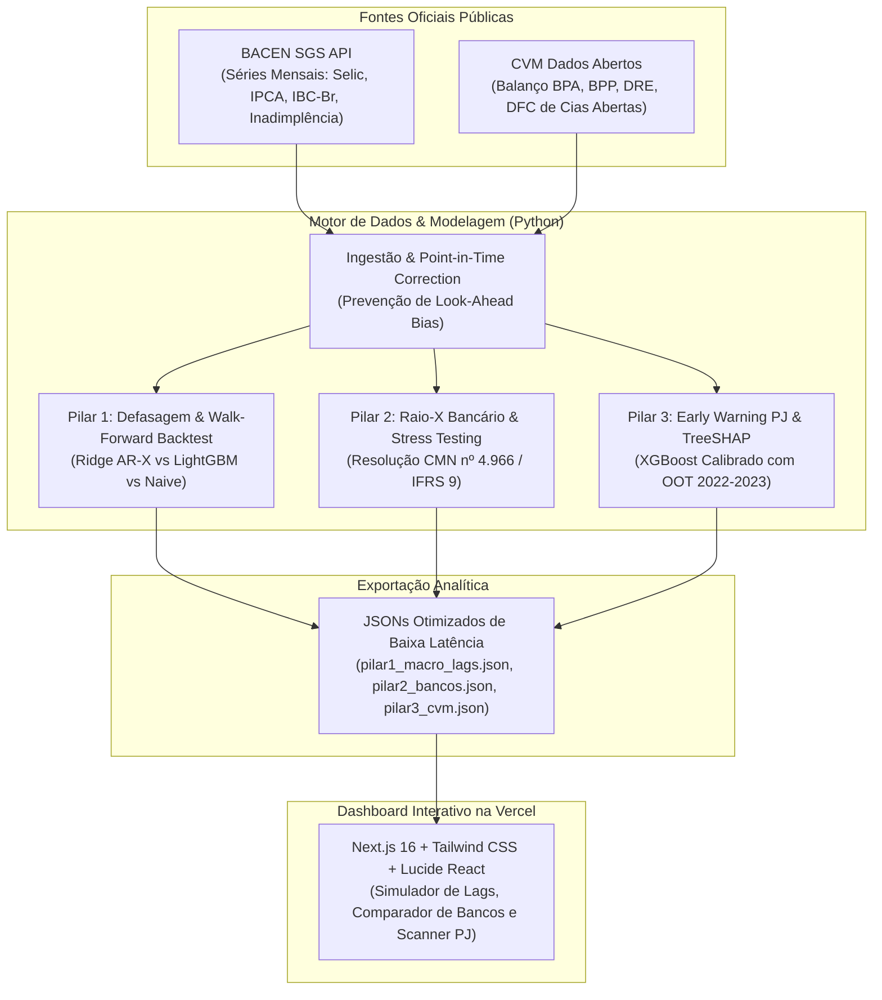

# Observatório de Risco do Sistema Financeiro Nacional (SFN)

> **Inteligência Analítica, Modelagem Preditiva e Backtesting com Dados Reais Oficiais do Banco Central do Brasil (BACEN) e da Comissão de Valores Mobiliários (CVM).**

[](https://www.python.org/)
[](https://nextjs.org/)
[]()
[](https://vercel.com/new/clone?repository-url=https%3A%2F%2Fgithub.com%2Ffabriciosdasilva%2Fobservatorio-risco-sfn&root-directory=web)

---

## 📌 Visão Geral & Propósito de Negócio

No setor bancário e no mercado financeiro brasileiro, áreas de **Risco de Crédito, Modelagem Quantitativa e Inteligência de Mercado** frequentemente operam em silos. Este projeto integra dados públicos oficiais das três esferas do crédito nacional em um produto analítico ponta a ponta:

1. **Esfera Macroeconômica (BACEN SGS):** Identificação empírica do tempo de defasagem (*transmission lags*) da taxa Selic na inadimplência das principais modalidades de crédito, com validação **Walk-Forward** e teste de **Diebold-Mariano**.
2. **Esfera Institucional (BACEN / CVM Balanços):** Análise da trajetória de ativos de trilhões, rentabilidade (ROE) e simulação de **Stress Testing prospectivo** alinhado à **Resolução CMN nº 4.966** e **IFRS 9** para as principais instituições financeiras (Itaú, Bradesco, Banco do Brasil, Santander, BTG, Inter, etc.).
3. **Esfera Corporativa (CVM DFP):** Painel com mais de **2.500 balanços contábeis auditados** e modelo de **Early Warning** (XGBoost Calibrado + TreeSHAP) avaliado estritamente **Out-of-Time (2022–2023)** para sinalizar distress financeiro de empresas antes de calotes formais.

---

## 📊 Principais Descobertas Empíricas (Key Findings)

* **Defasagem da Política Monetária:**
  * **Cartão de Crédito Rotativo:** Pico de correlação em **3 meses** ($r = 0.5403$). Resposta imediata ao aperto monetário. O modelo regularizado **Ridge AR-X** reduziu o erro (RMSE) em **22.02%** frente ao baseline ingênuo.
  * **Financiamento de Veículos:** Pico de defasagem de **5 meses** ($r = 0.6974$). O estresse atinge o ápice no segundo trimestre pós-choque de juros.
  * **Capital de Giro (PJ):** Pico de defasagem de **10 meses** ($r = 0.5738$). Empresas postergam e refinanciam passivos por quase um ano antes do pico da inadimplência.
  * **Crédito Consignado:** Resposta inversa ($r = -0.7975$ em 10 meses), com estabilidade assegurada por desconto em folha e garantias públicas.

* **Discriminação de Risco Corporativo (OOT 2022–2023):**
  * O modelo calibrado obteve **ROC-AUC de 0.9927**, **Gini de 0.9855** e **Estatística KS de 0.9605** no teste cego fora do tempo durante o ciclo agudo de Selic a 13,75%.
  * O algoritmo isolou com precisão casos como **Americanas S.A.** ($PD = 98.34\%$) e **Gol Linhas Aéreas** ($PD = 97.72\%$) na faixa de risco crítico (*CCC/Distress*), mantendo bancos e grandes exportadoras na faixa *AAA* ($PD < 1.0\%$).
  * A decomposição **TreeSHAP** apontou `ROE`, `Liquidez Corrente`, `Margem Líquida` e `Disponibilidades de Caixa` como os 4 maiores vetores determinantes de insolvência no mercado brasileiro.

---

## 🏗️ Arquitetura do Sistema



---

## 🛠️ Como Executar Localmente

### 1. Pré-requisitos
* Python 3.10+
* Node.js 18+ e npm

### 2. Configurar o Motor Python
```bash
# Criar e ativar o ambiente virtual
python -m venv .venv
# No Windows:
.\.venv\Scripts\activate
# No Linux/Mac:
source .venv/bin/activate

# Instalar dependências
pip install -r requirements.txt

# Executar os testes unitários
pytest tests/ -v

# Rodar os pipelines de ingestão e modelagem
python -m src.data_ingestion.bacen_sgs
python -m src.run_pilar1_pipeline
python -m src.data_ingestion.cvm_parser
python -m src.models.bank_peer_analysis
python -m src.models.corporate_credit_model
python -m src.export_web_artifacts
```

### 3. Rodar a Aplicação Web (Next.js)
```bash
cd web
npm install
npm run dev
```
Abra `http://localhost:3000` no seu navegador.

---

## 🚀 Deploy na Vercel

O dashboard foi projetado para deploy estático ultra-rápido na Vercel:

1. Suba o repositório para o seu GitHub:
   ```bash
   git add .
   git commit -m "feat: observatorio de risco do sfn com bacen e cvm"
   git push origin main
   ```
2. Na [Vercel](https://vercel.com/), clique em **Add New Project** e selecione este repositório.
3. Configure o **Root Directory** como `web`.
4. Clique em **Deploy**. O site estará no ar em menos de 1 minuto!

---

## 📜 Governança e Metodologia Científica
* **Zero Dados Proprietários:** O projeto respeita rigorosamente a Lei Complementar nº 105 (Sigilo Bancário) e a LGPD, utilizando estritamente dados públicos e oficiais.
* **Prevenção de Vazamento Temporal (*Strict Temporal Ordering*):** Nenhuma informação de trimestres futuros é utilizada nos pré-processadores ou no treino dos modelos de backtest.
